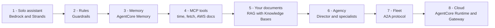

# Luna — from chatbot to an agency of AI agents, on AWS with Claude

Talk, live demo and starter kit for the **AWS User Group Ensenada**: a personal assistant that anyone can run, adapt with parameters, and grow step by step. It starts as one agent on your laptop and ends as a team of agents on AWS.

**De chatbot a agente: construimos un agente de IA en AWS con Claude.**



| What | Technologies |
|---|---|
| Brain | **Claude** Haiku 4.5 and Sonnet 4.6 on **Amazon Bedrock** (the 5.5 models when your account has quota for them), or the Claude API |
| Agent framework | **Strands Agents** (open source, AWS) |
| Tools | Python functions · **MCP** servers (open standard) · **AgentCore Gateway** |
| Rules | **Bedrock Guardrails** · human approval for risky actions |
| Memory | **AgentCore Memory** |
| Your documents (RAG) | **Bedrock Knowledge Bases** · **Amazon S3 Vectors** · Titan Text Embeddings V2 |
| Multi-agent | Director agent giving orders · **A2A** protocol (open standard) |
| Cloud | **AgentCore Runtime** · Observability with **OpenTelemetry** → CloudWatch · **AgentCore CLI** |
| Built with | **Claude Code** |


## Quickstart (level 1, about 15 minutes)

For level 1 you need an AWS account, Git, Python 3.11+, and AWS credentials on your machine (`aws configure` or `aws sso login`). The MCP levels add uv and Node.js 20.12+, and the cloud level adds the AgentCore CLI. Everything per level, with a check you can copy: [docs/prerequisites.md](docs/prerequisites.md).

1. **Turn on Claude in Bedrock (one time per account).** In the [Bedrock console](https://console.aws.amazon.com/bedrock/home?region=us-east-1#/model-catalog) for **us-east-1**, open the *Model catalog*, choose **Claude Haiku 4.5** and open it in the playground. The first time, AWS asks you to fill in Anthropic's short use-case form. Submit it and send one test message. This subscribes your account through AWS Marketplace; you pay only for the tokens you use.

   Luna uses Claude Haiku 4.5 and Sonnet 4.6 by default because they work on new accounts. The 5.5 models are newer, and Haiku 5.5 costs a tenth as much, but many accounts start with a **quota of 0** for them, and AWS may decline to raise it until the account has more history. To check yours and switch, see [docs/bedrock-access.md](docs/bedrock-access.md).

2. **Install:**
   ```bash
   git clone https://github.com/aws-ug-ensenada/claude-on-aws-ensenada.git
   cd claude-on-aws-ensenada/assistant
   python3 -m venv .venv && source .venv/bin/activate
   pip install -r requirements.txt
   ```

3. **Talk to it:**
   ```bash
   python luna.py --no-tools     # a plain chatbot: it can only guess
   python luna.py                # an agent: checks weather, rates, your to-do list
   ```
   Try: *"What should I wear today, and how much is 85 dollars in pesos? Add 'buy sunscreen' to my list."*

**Prefer the Claude API?** With an API key from the [Claude Console](https://platform.claude.com) (a Claude.ai subscription doesn't include one), you can use the newest Claude models right away:
```bash
read -rs ANTHROPIC_API_KEY && export ANTHROPIC_API_KEY      # paste the key; it isn't shown
python luna.py --set model.provider=anthropic --set model.id=claude-haiku-5-5 --set agency.director.model=claude-sonnet-5-5
```
Memory, your documents and the guardrail (for what you type) still run in AWS. See [docs/bedrock-access.md](docs/bedrock-access.md#the-claude-api-instead-of-bedrock).

**No AWS account and no code?** Start with [PartyRock](https://partyrock.aws/), AWS's free no-code app builder.

## Make it yours

```bash
python luna.py --preset student                      # or professional, family
python luna.py --set assistant.personality="a pirate" --set assistant.language=Spanish
python luna.py --mode agency                         # Director + planner, finance, organizer (+ researcher, office, librarian when on)
```

**Use it for any business.** Luna is not tied to one kind of business. Two fictional examples, a winery in Valle de Guadalupe and a coffee shop in Ensenada, show it working with your files, your documents and the web, through MCP servers. A clinic, a school, a farm, a law office or a repair shop is set up the same way:

```bash
python luna.py --preset coffee-shop --ask "What do I need to reorder this week, and from which supplier is espresso cheaper?"
python luna.py --preset winery --mode agency --ask "Prepare my Monday briefing and save it as a report."
```

Each business is one preset plus one folder (`assistant/business/`) plus your documents; copy an example, replace the text and the CSV files, and connect more MCP servers (Gmail, Drive, Slack…). How, step by step, and how the Strands Agents framework underneath works: [docs/extend.md](docs/extend.md). Also see [customize.md § 6–7](docs/customize.md#6-make-it-your-business).

Everything is a parameter in [`assistant/config.yaml`](assistant/config.yaml). See [docs/customize.md](docs/customize.md) to change the personality, the model, the tools, or the team of agents, and to add your own.

## Docs

| | |
|---|---|
| [docs/prerequisites.md](docs/prerequisites.md) | What to install and turn on before you start, per level |
| [docs/levels.md](docs/levels.md) | Step-by-step guide to all levels, with diagrams |
| [docs/extend.md](docs/extend.md) | **Start here to make it yours:** what Strands Agents is, how to use it, and the five changes that adapt Luna to any business |
| [docs/customize.md](docs/customize.md) | Parameters, presets, adding tools and agents |
| [docs/costs.md](docs/costs.md) | Full cost breakdown: under a cent per answer on Haiku, about $10 for the whole talk |
| [docs/comparison.md](docs/comparison.md) | Chat app vs local dev vs a fleet of agents: pros and cons |
| [docs/agenda.md](docs/agenda.md) · [docs/topics.md](docs/topics.md) | The talk: outline and researched topics |
| [docs/bedrock-access.md](docs/bedrock-access.md) | Turning on Claude in an account: use-case form, agreement, and the quotas to request |
| [docs/slides/](docs/slides/) | The talk's deck (`claude-on-aws-ensenada.pptx`, 31 slides) and its generator (`npm install && node build.js`) |
| [docs/demo-runbook.md](docs/demo-runbook.md) | Rehearse (`python rehearse.py`), record and run the talk's demo, scene by scene |
| [docs/plain-words.md](docs/plain-words.md) | Every concept in plain words, with everyday comparisons, for explaining it to anyone |
| [docs/production.md](docs/production.md) | From the laptop to production: where to run it and what to add for real users |
| [docs/next-steps.md](docs/next-steps.md) | Where the work stands, what's tested, and what to do next |

## Tests

Offline smoke tests (no AWS account, no model calls) check that every preset loads, every business folder exists, tool docstrings are clear, and every link in the docs points to a file. They run on every pull request.

```bash
cd assistant && pip install -r requirements-dev.txt && python -m pytest tests
```

`python rehearse.py` is the other kind of check: it runs the demo scenes against real AWS and Claude.

## Clean up

```bash
python setup/cleanup.py                              # guardrail, memory, knowledge base
agentcore remove all --yes && agentcore deploy --yes # cloud level: runtime, gateway, placeholder key
```

The CDK bootstrap stack (`CDKToolkit`) stays and costs nothing while idle. Level 8 also turns on CloudWatch Transaction Search for the account; lower its indexing to the free 1% with `aws xray update-indexing-rule --name Default --rule '{"Probabilistic":{"DesiredSamplingPercentage":1}}'`.

## Previous sessions

- [devops-agent-eks-demo](https://github.com/aws-ug-ensenada/devops-agent-eks-demo): AWS DevOps Agent diagnosing faults on EKS (April 2026).
