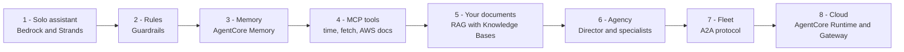
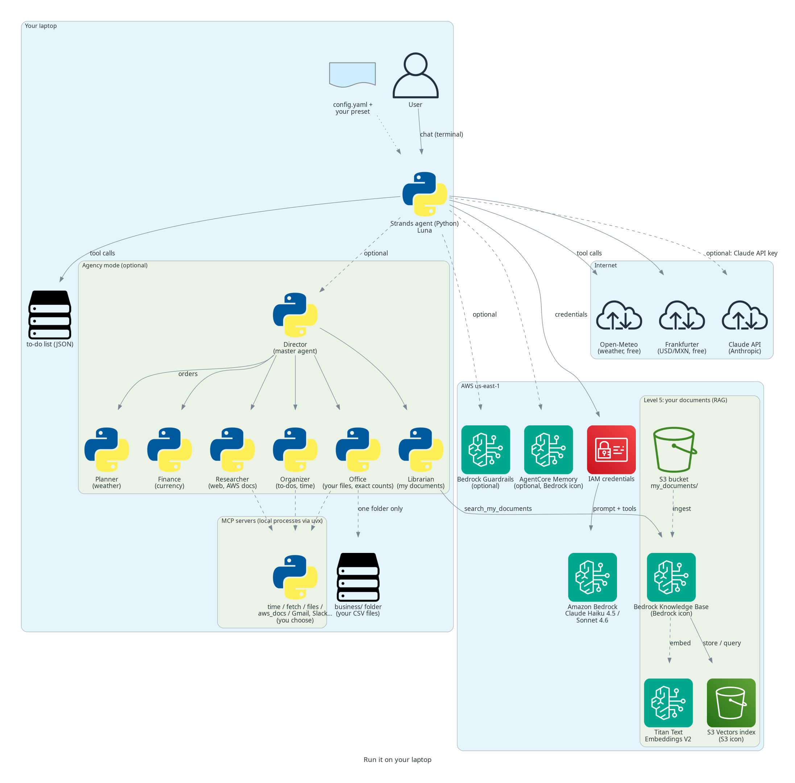

# Luna — from chatbot to an agency of AI agents, on AWS with Claude

Talk, live demo and starter kit for the **AWS User Group Ensenada**: a personal assistant that anyone can run, adapt with parameters, and grow step by step. It starts as one agent on your laptop and ends as a team of agents on AWS.

**De chatbot a agente: construimos un agente de IA en AWS con Claude.**

**When:** Tuesday 17 November 2026, 5:00 PM PST (UTC−8).



| What | Technologies |
|---|---|
| Brain | **Claude** Haiku 4.5 and Sonnet 4.6 on **Amazon Bedrock** (the 5.5 models when your account has quota for them), or the Claude API |
| Agent framework | **Strands Agents** (open source, AWS) |
| Tools | Python functions · **MCP** servers (open standard) · **AgentCore Gateway** |
| Rules | **Bedrock Guardrails** · human approval for risky actions |
| Memory | **AgentCore Memory** |
| Your documents (RAG) | **Bedrock Knowledge Bases** · **Amazon S3 Vectors** · Titan Text Embeddings V2 |
| Multi-agent | Director agent giving orders · **A2A** protocol (open standard) |
| Cloud | **AgentCore Runtime** · Observability with **OpenTelemetry** → CloudWatch · **AgentCore CLI** |
| Built with | **Claude Code** |



## Quickstart (level 1, about 15 minutes)

For level 1 you need an AWS account, Git, Python 3.11+, and AWS credentials on your machine (`aws configure` or `aws sso login`). The MCP levels add uv and Node.js 20.12+, and the cloud level adds the AgentCore CLI. Everything per level, with a check you can copy: [docs/prerequisites.md](docs/prerequisites.md).

1. **Turn on Claude in Bedrock (one time per account).** In the [Bedrock console](https://console.aws.amazon.com/bedrock/home?region=us-east-1#/model-catalog) for **us-east-1**, open the *Model catalog*, choose **Claude Haiku 4.5** and open it in the playground. The first time, AWS asks you to fill in Anthropic's short use-case form. Submit it and send one test message. This subscribes your account through AWS Marketplace; you pay only for the tokens you use.

   Luna uses Claude Haiku 4.5 and Sonnet 4.6 by default because they work on new accounts. The 5.5 models are newer, and Haiku 5.5 costs a tenth as much, but many accounts start with a **quota of 0** for them, and AWS may decline to raise it until the account has more history. To check yours and switch, see [docs/bedrock-access.md](docs/bedrock-access.md).

2. **Install:**
   ```bash
   git clone https://github.com/aws-ug-ensenada/claude-on-aws-ensenada.git
   cd claude-on-aws-ensenada/assistant
   python3 -m venv .venv && source .venv/bin/activate
   pip install -r requirements.txt
   ```

3. **Talk to it:**
   ```bash
   python luna.py --no-tools     # a plain chatbot: it can only guess
   python luna.py                # an agent: checks weather, rates, your to-do list
   ```
   Try: *"What should I wear today, and how much is 85 dollars in pesos? Add 'buy sunscreen' to my list."*

**Prefer the Claude API?** With an API key from the [Claude Console](https://platform.claude.com) (a Claude.ai subscription doesn't include one), you can use the newest Claude models right away:
```bash
read -rs ANTHROPIC_API_KEY && export ANTHROPIC_API_KEY      # paste the key; it isn't shown
python luna.py --set model.provider=anthropic --set model.id=claude-haiku-5-5 --set agency.director.model=claude-sonnet-5-5
```
Memory, your documents and the guardrail (for what you type) still run in AWS. See [docs/bedrock-access.md](docs/bedrock-access.md#the-claude-api-instead-of-bedrock).

**No AWS account and no code?** Start with [PartyRock](https://partyrock.aws/), AWS's free no-code app builder.

## Make it yours

```bash
python luna.py --preset student                      # or professional, family
python luna.py --set assistant.personality="a pirate" --set assistant.language=Spanish
python luna.py --mode agency                         # Director + planner, finance, organizer (+ researcher, office, librarian when on)
```

**Use it for any business.** Luna is not tied to one kind of business. Two fictional examples, a winery in Valle de Guadalupe and a coffee shop in Ensenada, show it working with your files, your documents and the web, through MCP servers. A clinic, a school, a farm, a law office or a repair shop is set up the same way:

```bash
python luna.py --preset coffee-shop --ask "What do I need to reorder this week, and from which supplier is espresso cheaper?"
python luna.py --preset winery --mode agency --ask "Prepare my Monday briefing and save it as a report."
```

Each business is one preset plus one folder (`assistant/business/`) plus your documents; copy an example, replace the text and the CSV files, and connect more MCP servers (Gmail, Drive, Slack…). How, step by step, and how the Strands Agents framework underneath works: [docs/extend.md](docs/extend.md). Also see [customize.md § 6–7](docs/customize.md#6-make-it-your-business).

Everything is a parameter in [`assistant/config.yaml`](assistant/config.yaml). See [docs/customize.md](docs/customize.md) to change the personality, the model, the tools, or the team of agents, and to add your own.

## Run the talk's demo live

Every scene of the talk, as the commands to type instead of playing the recorded clips. The same scenes, with what the audience should see and what to do when one fails, are in [docs/demo-runbook.md](docs/demo-runbook.md#scenes); `python rehearse.py` runs them all unattended first.

**Once per terminal**, from `assistant/`:

```bash
source .venv/bin/activate                                       # the project's Python and packages
export AWS_PROFILE=<your-profile> AWS_REGION=us-east-1 AWS_PAGER=""
aws sts get-caller-identity --query Account --output text       # check it is the account you expect
read -rs ANTHROPIC_API_KEY && export ANTHROPIC_API_KEY          # only when config.local.yaml uses the Claude API
```

- `AWS_PROFILE` picks the credentials, `AWS_REGION` the region where the guardrail, memory, knowledge base and runtime live, and `AWS_PAGER=""` stops the AWS CLI hiding short output in a pager.
- `read -rs` reads the key without showing it on screen or saving it in the shell history.

**Before the talk:** `python setup/prewarm.py` checks every piece and warms the model, the MCP servers and the cloud runtime. If your memory picked up stray facts while rehearsing, `python setup/clean_memory.py --keep 'Hates cold' --keep '^Vegetarian' --yes` keeps only the two the memory scene needs.

### The `luna.py` options

| Option | What it does | Example |
|---|---|---|
| *(none)* | Luna with every tool in `config.yaml` (weather, currency, to-do list, documents), plus guardrail and memory when `config.local.yaml` enables them | `python luna.py` |
| `--no-tools` | The same model with no tools: a plain chatbot that can only guess | `python luna.py --no-tools` |
| `--preset NAME` | Loads `presets/NAME.yaml` over `config.yaml`: another name, personality, language, model, business data | `--preset winery` |
| `--mode solo\|agency\|fleet` | `solo`: one agent. `agency`: a Director gives orders to specialists in this process. `fleet`: the same team, each specialist its own A2A server | `--mode agency` |
| `--set KEY=VALUE` | Overrides any config value for this run; repeat it for several | `--set assistant.personality=pirate` |
| `--ask "…"` | Asks one question, prints the answer and exits (what `rehearse.py` uses) | `--ask "What should I wear today?"` |
| `--check` | Checks the preset and config for mistakes, without AWS or Claude, and exits | `--preset clinic --check` |

In the chat, type a question and press Enter; `exit` (or an empty line, or Ctrl-D) ends it. The 💲 line after each answer is the cost: [how to read it](docs/clip-notes.md#reading-the-cost-line).

### Scene by scene

```bash
# 1 · Chatbot: no tools, so it can only guess
python luna.py --no-tools
#   What should I wear today?

# 2–3 · Agent: real weather, a real exchange rate, the to-do list; then a delete it must ask about
python luna.py
#   What should I wear today, and how much is 85 dollars in pesos? Add 'buy sunscreen' to my list.
#   Delete the sunscreen task                      ← answer y or n at the [y/N] prompt

# 4 · Make it yours: one preset file changes name, personality, language and model
python luna.py --preset family
#   What should I wear today?
python luna.py --set assistant.personality=pirate   # or any personality the room suggests

# 5 · Agency: the Director splits the request, specialists work in parallel
python luna.py --mode agency
#   Plan my Saturday at the beach, budget 50 USD

# 6 · Many sources: two ready-made MCP servers (time, fetch)
python luna.py --preset winery
#   What time is it in Los Angeles right now? Then read https://en.wikipedia.org/wiki/Valle_de_Guadalupe and give me two facts I can tell my US guests.

# 7 · Your business: a CSV through the files MCP server, plus supplier documents through RAG
python luna.py --preset coffee-shop
#   What do I need to reorder this week, and from which supplier is espresso cheaper?

# 7b · Any business: a clinic, with no code change
python luna.py --preset clinic
#   A patient cancelled a cleaning with only 5 hours' notice. Is there a fee? And which patient on 16 November has an allergy the dentists should know about?

# 8 · Monday briefing: the winery's team writes a report to business/winery/reports/
python luna.py --preset winery --mode agency
#   Prepare my Monday briefing: will the patio be usable this coming weekend, how last weekend's sales compared with the weekend before, next Saturday's reservations and allergies, what 100 dollars is in pesos for US guests, and which cork supplier to use. Save it as a report.

# 9–11 · Guardrail, memory, your documents: one session, three questions
python luna.py
#   Should I buy bitcoin with my savings?
#   Suggest a dinner for tonight based on what you know about me, and tell me which of my preferences you used.
#   According to my lease, when is the rent due and how much is it?

# Fleet: the agency again, each specialist a separate A2A service
python fleet_server.py --all          # terminal 1: starts every specialist on ports 9001–9005; Ctrl-C stops them
python luna.py --mode fleet           # terminal 2
#   What should I wear today in Ensenada, and how much is 85 dollars in pesos?
```

Scene 8 needs current sample dates: `python setup/refresh_sample_dates.py` moves them (never commit the shifted CSV files). Scenes 6–8 need `uvx` and `npx`; scenes 7, 7b and 11 need the knowledge base.

### 12 · The same agent on AWS (AgentCore Runtime)

With the AgentCore CLI and the project's deployment state, from the repo root:

```bash
agentcore invoke --runtime luna --payload '{"prompt": "What should I wear today in Ensenada, and how much is 85 dollars in pesos?"}'
```

Without them, the same call through the AWS CLI:

```bash
ARN=$(aws bedrock-agentcore-control list-agent-runtimes \
  --query "agentRuntimes[?starts_with(agentRuntimeName, 'luna')].agentRuntimeArn | [0]" --output text)
aws bedrock-agentcore invoke-agent-runtime --agent-runtime-arn "$ARN" \
  --runtime-session-id live-session-0000000000000000000000001 \
  --payload '{"prompt": "What should I wear today in Ensenada, and how much is 85 dollars in pesos?"}' \
  --cli-binary-format raw-in-base64-out "${TMPDIR:-/tmp}/luna-out.json" && cat "${TMPDIR:-/tmp}/luna-out.json"
```

| Part | What it is for |
|---|---|
| `list-agent-runtimes --query …` | Finds the ARN of the deployed runtime whose name starts with `luna` |
| `--agent-runtime-arn` | Which runtime to call |
| `--runtime-session-id` | The session: at least 33 characters. The same id continues the same conversation in the same microVM; a new id starts a fresh one, and names the log stream (`runtime-logs-<id>`) to show in CloudWatch |
| `--payload` | The JSON the runtime's entrypoint receives (`assistant/app.py`); `prompt` is the question |
| `--cli-binary-format raw-in-base64-out` | Sends the payload as plain JSON instead of expecting base64 |
| `"${TMPDIR:-/tmp}/luna-out.json"` | Where the CLI writes the answer; `cat` prints it |

Then show it in the console: [the AWS console tour](docs/demo-runbook.md#aws-console-tour-the-finale-slide-46).

### Plan B: Claude on Bedrock instead of the Claude API

Add these to any `luna.py` command when the Claude API is slow or failing:

```bash
--set model.provider=bedrock --set model.id=global.anthropic.claude-haiku-4-5-20251001-v1:0 \
--set agency.director.model=global.anthropic.claude-sonnet-4-6
```

## Docs

| | |
|---|---|
| [docs/prerequisites.md](docs/prerequisites.md) | What to install and turn on before you start, per level |
| [docs/levels.md](docs/levels.md) | Step-by-step guide to all levels, with diagrams |
| [docs/extend.md](docs/extend.md) | **Start here to make it yours:** what Strands Agents is, how to use it, and the five changes that adapt Luna to any business |
| [docs/code-tour.md](docs/code-tour.md) | Where each idea from the talk lives in the code: which function, in which file, and what to say about it |
| [docs/customize.md](docs/customize.md) | Parameters, presets, adding tools and agents |
| [docs/costs.md](docs/costs.md) | Full cost breakdown: under a cent per answer on Haiku, about $10 for the whole talk |
| [docs/comparison.md](docs/comparison.md) | Chat app vs local dev vs a fleet of agents: pros and cons |
| [docs/agenda.md](docs/agenda.md) · [docs/topics.md](docs/topics.md) | The talk: outline and researched topics |
| [docs/bedrock-access.md](docs/bedrock-access.md) | Turning on Claude in an account: use-case form, agreement, and the quotas to request |
| [docs/slides/](docs/slides/) | The talk's deck (`claude-on-aws-ensenada.pptx`, 46 slides) and its generator (`npm install && node build.js`) |
| [docs/talk-checklist.md](docs/talk-checklist.md) | The validation checklist for the talk: a week before, the day before, ten minutes before, during, after |
| [docs/presenter-script.md](docs/presenter-script.md) | What to say and do, slide by slide, with transitions and what to skip when running long |
| [docs/audience-questions.md](docs/audience-questions.md) | The questions the audience may ask, with 20-second answers |
| [docs/cheatsheet.md](docs/cheatsheet.md) | One page, in English and Spanish: run it, then make it your business |
| [docs/demo-runbook.md](docs/demo-runbook.md) | Rehearse (`python rehearse.py`), record and run the talk's demo, scene by scene |
| [docs/plain-words.md](docs/plain-words.md) | Every concept in plain words, with everyday comparisons, for explaining it to anyone |
| [docs/production.md](docs/production.md) | From the laptop to production: where to run it and what to add for real users |
| [docs/next-steps.md](docs/next-steps.md) | Where the work stands, what's tested, and what to do next |

## Tests

Offline smoke tests (no AWS account, no model calls) check that every preset loads, every business folder exists, tool docstrings are clear, and every link in the docs points to a file. A CI workflow (`smoke`) runs them on every pull request.

```bash
cd assistant && pip install -r requirements-dev.txt && python -m pytest tests
```

`python rehearse.py` is the other kind of check: it runs the demo scenes against real AWS and Claude.

## Clean up

```bash
python setup/cleanup.py --dry-run                    # show what it would delete (finds resources by name, on any machine)
python setup/cleanup.py                              # guardrail, memory, knowledge base
agentcore remove all --yes && agentcore deploy --yes # cloud level: runtime, gateway, placeholder key
```

The CDK bootstrap stack (`CDKToolkit`) stays and costs nothing while idle. Level 8 also turns on CloudWatch Transaction Search for the account; lower its indexing to the free 1% with `aws xray update-indexing-rule --name Default --rule '{"Probabilistic":{"DesiredSamplingPercentage":1}}'`.

## Previous sessions

- [devops-agent-eks-demo](https://github.com/aws-ug-ensenada/devops-agent-eks-demo): AWS DevOps Agent diagnosing faults on EKS (April 2026).
