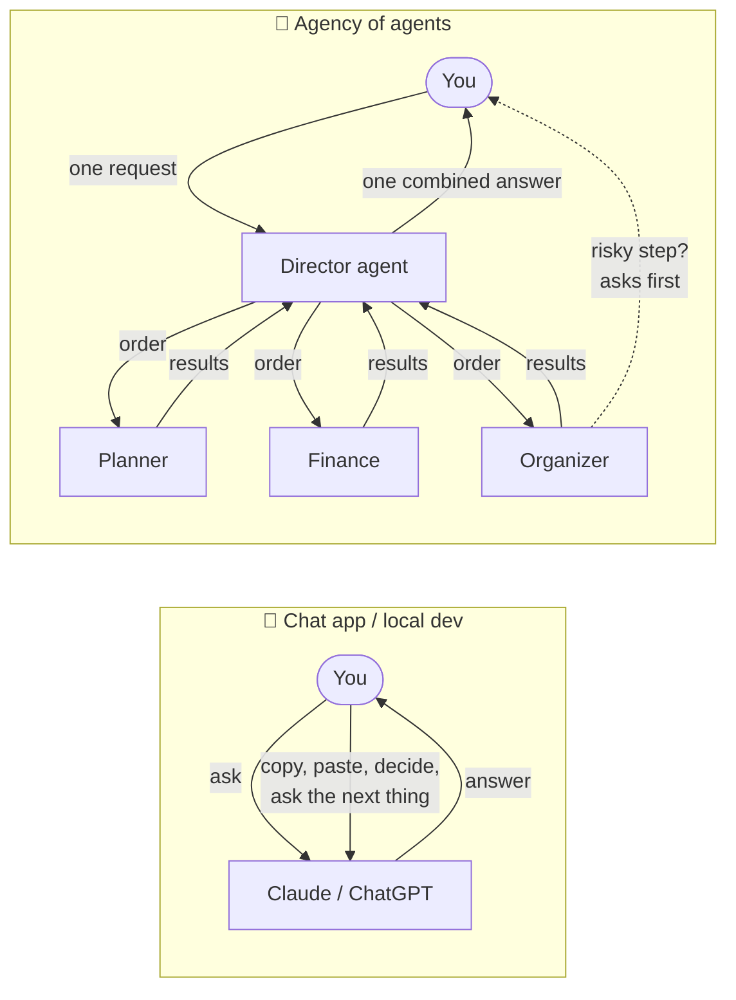

# Chat app, local development, or a fleet of agents?

All three use the same kind of model — Claude, GPT and others. The difference is **who drives**, **where it runs**, and **who it works for**.

| | 💬 Chat app | 🧑‍💻 Local dev assistant | 🤖 Your own agent | 🏢 Agency / fleet of agents |
|---|---|---|---|---|
| Examples | claude.ai, ChatGPT | Claude Code, Kiro, Cursor | Luna in solo mode | Luna's Director + specialists on AgentCore |
| Who drives | **You**, one message at a time | You, approving the agent's steps | The agent, inside rules you wrote | A **Director agent** that gives orders to other agents |
| Runs on | The vendor's app | Your laptop | Your laptop or the cloud | The cloud (AgentCore Runtime), always on |
| Works for | One person | One developer | One person or a team | Many users and systems at once |
| Tools / data | What the app offers, plus files you paste | Your code, terminal, MCP servers | Exactly the tools you give it | Shared tools (MCP via AgentCore Gateway), per-agent permissions |
| Rules | The vendor's | Permission prompts on your machine | Your instructions + Guardrails | Guardrails, IAM per agent, human approval for risky steps |
| Memory | Per account, app-managed | Per project (files like CLAUDE.md) | AgentCore Memory, yours | Shared and per-agent memory, yours |
| Cost model | Flat subscription (~$20/month) | Subscription or pay per token | **Pay per token** — cents | Pay per token **× number of agents** + small hosting costs |
| Visibility | Chat history | Terminal output | Cost per answer | Traces of every order between agents (OpenTelemetry → CloudWatch) |
| Setup | None | Minutes | ~15 minutes | Hours, plus ongoing operations |

## How the work flows

In a chat, **you are the orchestrator**: you split the problem, carry information between steps and decide what's next. In an agency, **the Director is the orchestrator** and you become the approver.

## Pros and cons

### 💬 Chatting with Claude / ChatGPT, or 🧑‍💻 developing locally with an assistant

**Pros**
- Zero or minimal setup; the best tool for exploring, learning and one-off questions.
- You see and steer every step, so mistakes get caught early.
- Predictable cost (flat subscription) for heavy personal use.
- Local dev assistants work directly on your code and files, with your permissions.

**Cons**
- Only works while you're there — nothing happens when you close the window.
- You are the glue: copying data between apps doesn't scale past one person.
- Hard to repeat exactly the same process twice or share it with a team.
- Limited control over rules, data location and which tools it may use.

### 🏢 A fleet / agency of agents

**Pros**
- **Runs without you**: on a schedule, from an event, or for many users at the same time.
- **Specialists do better work**: each agent has a short, focused prompt and only the tools it needs.
- **Least privilege**: the Finance agent can't touch the to-do list; each one gets its own permissions.
- **Mix models to save money**: a cheap, fast model for simple specialists, a stronger one for the Director.
- **Repeatable and observable**: the same process every time, with a trace of every order.
- **Reusable**: specialists can serve other agents over A2A, and tools can be shared through MCP.

**Cons**
- **More cost per question**: one request becomes several model calls (in Luna, roughly 3–5×).
- **Slower**: orders and hand-offs add seconds.
- **More to break**: networking, permissions, timeouts — agents can misunderstand each other.
- **Harder to debug**: you need tracing to know which agent did what.
- **Operations**: deployments, versions, monitoring and security reviews — it's a production system.
- **Overkill for simple tasks**: if one agent with three tools can do it, use one agent.

## When to choose which

| Situation | Choose |
|---|---|
| Learning, brainstorming, one-off questions | Chat app |
| Writing and changing code on your machine | Local dev assistant (Claude Code, Kiro) |
| A task you repeat often, with your own data and tools | Your own agent |
| Several distinct skills, many users, must run unattended, or must be audited | Agency / fleet of agents |

**Rule of thumb:** start with one agent. Split into several only when one prompt is doing too many unrelated jobs, when different parts need different permissions, or when parts should be reused by other agents.
