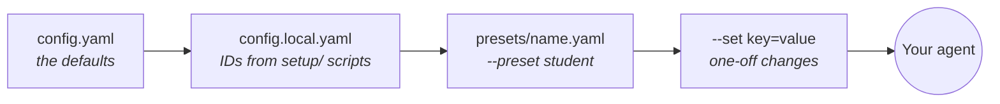

# Make it yours

Everything the assistant does comes from parameters, so you don't have to change any code. You can change them in four ways, applied in this order (each one overrides the ones before it):



## 1. Edit `config.yaml` (no code)

| Parameter | What it changes | Try |
|---|---|---|
| `assistant.name` | Its name | `Atlas` |
| `assistant.personality` | How it talks (free text) | `funny`, `like a coach`, `formal` |
| `assistant.language` | `auto` replies in your language; or force one | `Spanish` |
| `assistant.answer_length` | `short` / `medium` / `detailed` | `detailed` |
| `assistant.extra_instructions` | Any extra rule, in plain words | "Always suggest a free option" |
| `user.*` | Who you are: name, city, currency, about you | `city: Tijuana` |
| `gateway.tools` | Level 8: tool groups the AgentCore Gateway serves in the cloud (one target per group, same name) | `[weather, currency]` |
| `model.provider` | `bedrock` (AWS) or `anthropic` (Claude API key; the guardrail then checks only what you type, see [bedrock-access.md](bedrock-access.md#the-claude-api-instead-of-bedrock)) | `anthropic` |
| `model.id` | Which Claude: Haiku (cheap), Sonnet, Opus (smart). Claude 5.x models ignore `model.temperature` | `global.anthropic.claude-sonnet-4-6` |
| `model.temperature` | 0 = predictable, 1 = creative | `0.8` |
| `tools` | Which tools it may use | remove `todo` |
| `mode` | `solo`, `agency`, `fleet` | `agency` |
| `agency.agents` | The team: name, role, tools, model | add your own agent |
| `guardrail`, `memory`, `knowledge_base`, `mcp_servers` | Optional AWS / MCP levels (the setup scripts switch them on) | `enabled: true` |
| `knowledge_base.results` | How many passages each document search returns | `6` |
| `show_cost` | Print tokens and $ after each answer | `false` |

## 2. Use a preset

```bash
python luna.py --preset student        # study buddy, budget-minded
python luna.py --preset professional   # concise, uses Sonnet
python luna.py --preset family         # warm, Spanish, explains simply
python luna.py --preset winery         # owner of a winery & restaurant: files, web, time (section 6)
python luna.py --preset coffee-shop    # owner of a coffee shop: same tools, different business
```

To make your own, copy a file in `presets/`. You only need to include the values you want to change.

## 3. Override on the command line

```bash
python luna.py --set assistant.personality="a pirate" --set model.temperature=0.9
python luna.py --set user.city="La Paz, BCS" --set assistant.language=English
```

## 4. Add a tool (a little Python)

Copy `tools/currency.py` to `tools/mytool.py`, then:

1. Write a function with the `@tool` decorator and a clear docstring. The model reads the docstring to decide when to use the tool.
2. List it in `TOOLS = [...]` at the bottom of the file. If the tool needs settings from the config, define `tools(cfg)` instead and return the list from it, as `tools/documents.py` does.
3. Add `mytool` to `tools:` in `config.yaml`.

Or ask a coding assistant to do it: *"Add a tool in tools/ that returns today's gas price in Baja California, following the pattern in tools/currency.py."*

## 5. Add an agent to the agency (no code)

```yaml
agency:
  agents:
    # …existing agents…
    - name: chef
      role: Suggests meals and builds shopping lists.
      instructions: Prefer local Baja ingredients. Keep recipes under 30 minutes.
      tools: [todo]                              # can add shopping items to the list
      model: global.anthropic.claude-sonnet-4-6   # optional, defaults to model.id
      url: http://127.0.0.1:9007                 # only for fleet mode; one free port per agent
```

The Director reads the roster and starts giving orders to `chef` the next time you run it. An agent whose tools aren't switched on yet, such as `librarian` before the knowledge base exists, sits out until they are.

## 6. Make it your business

Luna works for any business. The repo has two fictional examples, a winery and restaurant (**Bodega Cielo Alto**, Valle de Guadalupe) and a coffee shop (**Café Brisa**, Ensenada); a clinic, school, farm or office is built the same way (see [extend.md](extend.md) for the full walkthrough and ideas by industry). A third example, a dental clinic (`--preset clinic`), shows the same pattern outside food and drink. Each example is one preset plus one folder:

| Piece | Winery | Coffee shop | What it's for |
|---|---|---|---|
| Preset | `presets/winery.yaml` | `presets/coffee-shop.yaml` | Who the owner is, what Luna should care about, which MCP servers are on |
| Business folder | `business/winery/` | `business/coffee-shop/` | Files Luna reads and writes through the `files` MCP server: sales, reservations, inventory; reports go to `reports/` |
| Documents | `my_documents/bodega-cielo-alto-*.md` | `my_documents/cafe-brisa-*.md` | Handbook and supplier prices, searched with RAG (level 5) |

Try them:

```bash
python luna.py --preset coffee-shop --ask "What do I need to reorder this week, and from which supplier is espresso cheaper?"
python luna.py --preset winery --mode agency --ask "Prepare my Monday briefing and save it as a report."
```

To make your own:

1. Copy `presets/coffee-shop.yaml` to `presets/my-business.yaml`. Change `extra_instructions` and `user.about` to describe your business, and point `mcp_servers.files.root` at your folder.
2. Copy `business/coffee-shop/` to `business/my-business/` and replace the CSV files with your own exports (sales, stock, bookings…). Plain CSV or Markdown works best.
3. Put documents people ask about (policies, price lists, menus, contracts) in `my_documents/` and run `python setup/create_knowledge_base.py --sync`.
4. `python luna.py --preset my-business`

**Files or documents?** Use the business folder for data that changes and that Luna may update (sales, stock, reports). Use `my_documents/` for reference text Luna should search and quote (handbooks, contracts, price lists).

## 7. Connect more MCP servers

MCP servers are listed in `mcp_servers` in `config.yaml`. Switch one on for a single run with `--set mcp_servers.<name>.enabled=true`, or in a preset.

| Server | What it gives Luna | Login | In the repo |
|---|---|---|---|
| `time` | Current time, time zones | None | ✅ tested |
| `fetch` | Read any public web page | None | ✅ tested |
| `files` | Read and write files in **one** folder | None | ✅ tested |
| `aws_docs` | Search the AWS documentation | None | ✅ tested |
| `gmail` | Read your Gmail | Your Google OAuth client | ✅ tested (read-only) |

Add any other server the same way. The [MCP server list](https://github.com/modelcontextprotocol/servers) and [AWS MCP servers](https://awslabs.github.io/mcp/) have hundreds: GitHub, Slack, Google Drive, Notion, databases, CRMs, calendars.

```yaml
mcp_servers:
  my_server:
    enabled: true
    command: uvx                 # or npx for Node.js servers
    args: ["some-mcp-server"]
    pass_env: [SOME_API_KEY]     # only these variables reach the server
  my_remote_server:              # a server that runs elsewhere
    enabled: true
    url: https://example.com/mcp
    headers_env: {Authorization: MY_SERVER_TOKEN}   # header ← environment variable
```

Give an agency member access by adding the server's name to its `mcp:` list, as the `office` agent does with `files`.

**Be careful what you connect.** An MCP server runs code on your machine and sees what the agent sends it. Use servers you trust, give each one as little as possible (one folder, read-only, a narrow API key), and keep secrets in environment variables, never in `config.yaml`. Luna passes a server only the variables listed in its `pass_env`.

### Gmail

Luna's config has a `gmail` entry for the community server [`workspace-mcp`](https://github.com/taylorwilsdon/google_workspace_mcp) in read-only mode. It isn't tested in this repo, because it needs your own Google credentials:

1. In the [Google Cloud console](https://console.cloud.google.com/), create a project, enable the **Gmail API**, configure the **OAuth consent screen** (add yourself as a test user) and create an **OAuth client ID** of type *Desktop app*.
2. Export the client's ID and secret (never put them in `config.yaml`), and your Gmail address so the agent never has to ask for it:
   ```bash
   export GOOGLE_OAUTH_CLIENT_ID=...  GOOGLE_OAUTH_CLIENT_SECRET=...
   export USER_GOOGLE_EMAIL=you@gmail.com
   ```
3. Run Luna **interactively** with it switched on. The first Gmail question prints a Google sign-in link; open it, allow access, then ask again in the same session (the sign-in needs the server still running, so `--ask` alone can't finish it):
   ```bash
   python luna.py --set mcp_servers.gmail.enabled=true
   ```
   Then: *"Summarise the unread emails from suppliers this week."* After that first sign-in, `--ask` works too.

The sign-in is saved in `~/.google_workspace_mcp/credentials`, one per Google account. If another tool on your machine also uses `workspace-mcp` with different services, give each its own folder with `WORKSPACE_MCP_CREDENTIALS_DIR`, or each sign-in replaces the other's permissions.

Google also offers an [official Gmail MCP server](https://developers.google.com/workspace/gmail/api/guides/configure-mcp-server) at `https://gmailmcp.googleapis.com/mcp/v1`. It is in developer preview and needs enrolment in Google's Workspace Developer Preview Program, plus an OAuth flow per user.

