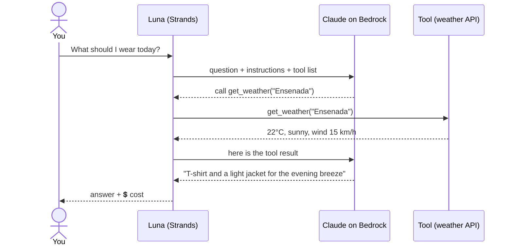
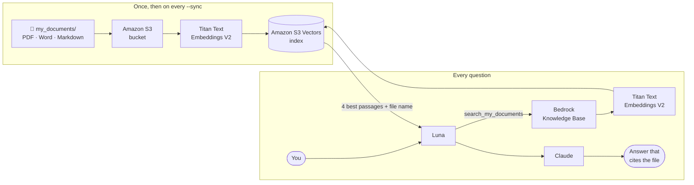
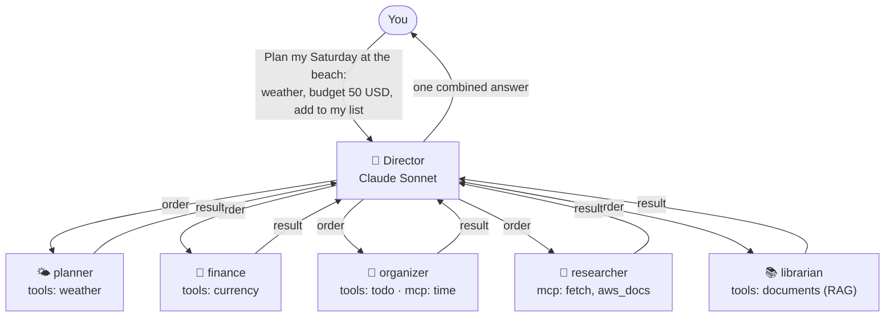
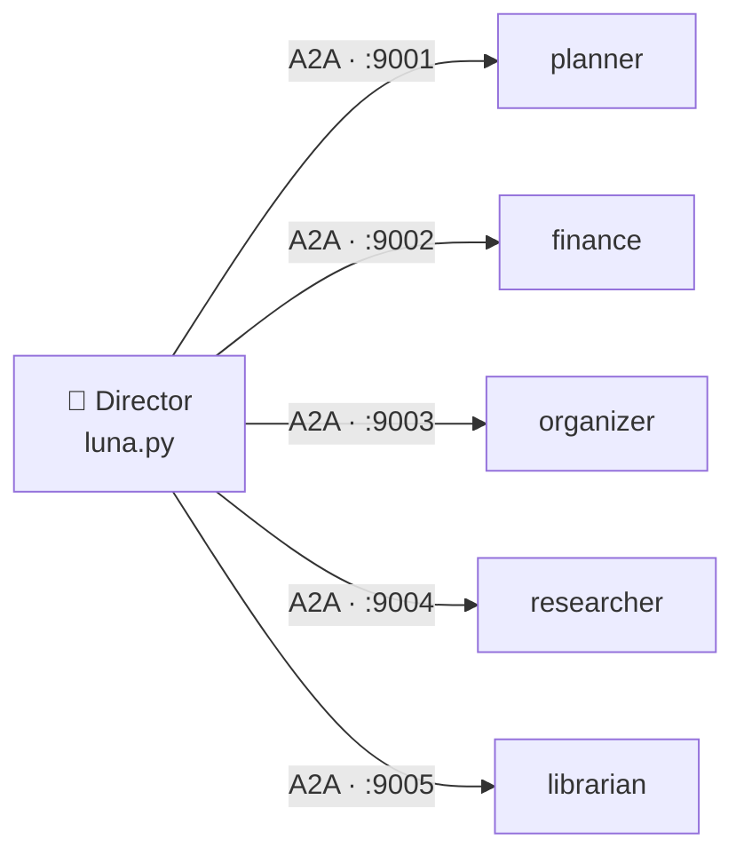
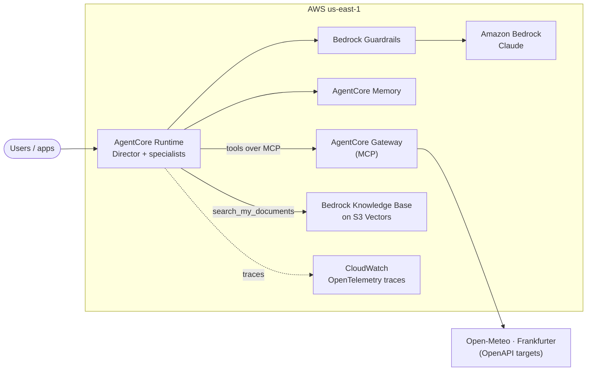
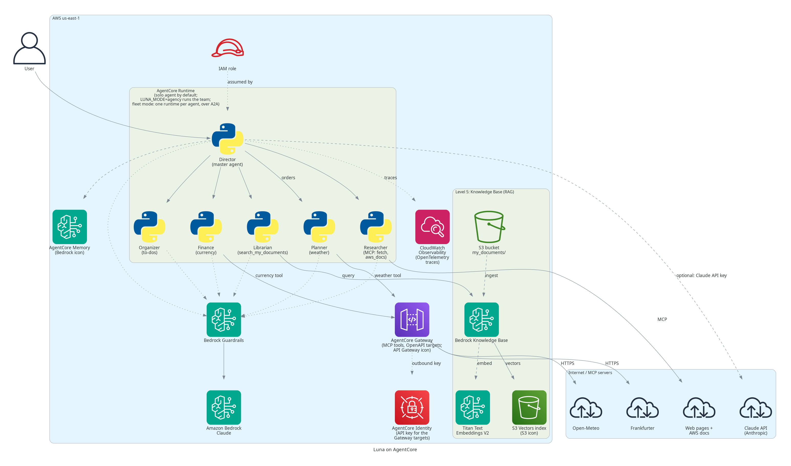

# Levels

Each level adds one idea. Run every command from `assistant/` with the virtual environment active. Levels 1, 4, 6 and 7 create **no AWS resources** and only use Bedrock model calls. Levels 2, 3, 5 and 8 create resources, and `setup/cleanup.py` (or the AgentCore CLI) deletes them.

## What an agent is



**Agent = brain (the model) + hands (tools) + rules (instructions, guardrails).** The model decides which tool to call, and the agent framework runs it and feeds the result back. This loop repeats until the model has an answer.

## 1 · Solo assistant

Before the first run, the account needs Claude turned on in Bedrock and a tokens-per-minute quota above 0 for the models you use. See [bedrock-access.md](bedrock-access.md).

```bash
python luna.py --no-tools    # brain only: it can only guess
python luna.py               # brain + hands
```

It has three tool groups: `weather` (Open-Meteo), `currency` (Frankfurter) and `todo` (a local file). Deleting a task **asks you first**, which is the simplest form of human-in-the-loop.

## 2 · Rules: Amazon Bedrock Guardrails

```bash
python setup/create_guardrail.py
python luna.py
```

The guardrail blocks investment advice and medical diagnosis, filters harmful content and prompt attacks, and masks card numbers, emails and phone numbers. Try: *"Should I buy bitcoin?"* Edit the topics in `setup/create_guardrail.py`, then apply the changes with `python setup/create_guardrail.py --update`.

**Guardrails and memory interact.** Memory (level 3) adds what it knows about you to your message as a block of structured text. With the prompt-attack filter at HIGH, the guardrail flagged that block as an injection (at LOW confidence) and refused ordinary questions like *"Suggest a dinner based on what you know about me"*. The filter is set to MEDIUM for that reason: *"Ignore all previous instructions…"* is still blocked. Each layer you add can change how the others behave, so test them together.

## 3 · Memory: Amazon Bedrock AgentCore Memory

```bash
python setup/create_memory.py    # 2–3 minutes
python luna.py                   # say: "I'm vegetarian and I hate the cold"
python luna.py                   # new session: "Plan dinner for tonight"
```

AgentCore extracts **preferences** from conversations and gives them back to the agent in later sessions.

## 4 · MCP: plug in other people's tools

MCP (Model Context Protocol) is an open standard for connecting AI to tools: think USB-C for AI. Free servers are ready in `config.yaml`; they need [uv](https://docs.astral.sh/uv/), and `files` also needs Node.js:

| Server | Gives the agent | Login |
|---|---|---|
| `time` | Current time, time-zone conversion | None |
| `fetch` | Reads any public web page as text | None |
| `files` | Reads and writes files in **one** folder (the official filesystem server) | None |
| `aws_docs` | Searches and reads the AWS documentation | None |
| `gmail` | Reads your Gmail (opt-in, read-only) | Your Google OAuth client |

```bash
python setup/check_mcp.py      # starts each server and lists its tools, without calling Claude
python luna.py --preset winery  # a business owner's assistant: time, fetch and files switched on
```

Try with `--preset winery`: *"What time is it in Los Angeles? Then read https://en.wikipedia.org/wiki/Valle_de_Guadalupe and give me two facts for my US guests."* · *"How did this weekend's sales compare with the weekend before?"* Or with `--set mcp_servers.aws_docs.enabled=true`: *"What does the AWS documentation say about AgentCore Memory strategies?"*

How to add any other server (GitHub, Slack, Drive, a CRM…) and set up Gmail: [customize.md § 7](customize.md#7-connect-more-mcp-servers).

These servers are third-party code that `uvx` or `npx` downloads and runs on your machine. Read what a server does before you enable it. Luna gives each server only the environment variables listed in its `pass_env`, and the `files` server only its one folder.

## 5 · Your documents (RAG): Amazon Bedrock Knowledge Bases

The model knows a lot about the world but nothing about *your* lease, *your* insurance or *your* grandmother's recipes. **RAG** (retrieval-augmented generation) fixes that: before answering, the agent searches your documents and gives the model the passages it finds.

```bash
python setup/create_knowledge_base.py           # about 2 minutes: uploads my_documents/ and indexes it
python luna.py                                  # "¿Qué día se paga la renta y qué pasa si me atraso?"
python setup/create_knowledge_base.py --sync    # after you add or change files
```



`my_documents/` comes with three fictional samples to try: a rental contract in Spanish, a car insurance summary and family recipes. Ask in English about the Spanish contract: embeddings match meaning, not exact words, so it works across languages. Replace the samples with your own files; nothing in the folder leaves your account.

- **Why S3 Vectors:** you pay for storage and queries only, so a small knowledge base costs cents a month. The console's default store, OpenSearch Serverless, bills compute by the hour even when nobody uses it: about $175–350 a month. See [costs.md](costs.md).
- **In the agency:** the `librarian` agent gets the `documents` tool and joins the team once the knowledge base exists. Until then it sits out, as does `researcher` while its MCP servers are off.
- **Security:** the setup script creates an IAM role that can only call the Titan embedding model, read this one bucket and write this one vector index.

## 6 · Agency: a Director gives orders

```bash
python luna.py --mode agency
```



The Director never does the work itself. It splits the request into orders, sends each one to a specialist, and combines the results. Every order appears on screen, along with the cost **per agent**. Each specialist only has the tools it needs. Add your own agent in `config.yaml` (see [customize.md](customize.md)).

## 7 · Fleet: agents as separate services (A2A)

```bash
python fleet_server.py --all     # terminal 1: each specialist on its own port
python luna.py --mode fleet      # terminal 2: the Director talks to them over A2A
```



A2A (Agent-to-Agent) is an open protocol. Each agent publishes an *agent card* that describes what it can do, for example http://127.0.0.1:9001/.well-known/agent-card.json, and can be written in any framework or language. Agents can run on different machines and be owned by different teams.

## 8 · Cloud: AgentCore Runtime, Gateway and Observability



The repo is already an AgentCore CLI project: [`agentcore/agentcore.json`](../agentcore/agentcore.json) declares one runtime, `luna`, whose code is the `assistant/` folder itself, with `app.py` as the entrypoint. The CLI packages that folder with the dependencies in [`assistant/pyproject.toml`](../assistant/pyproject.toml). There's no second copy of the code. You need Node.js 20.12+ and [uv](https://docs.astral.sh/uv/). Tested with AgentCore CLI 1.0.1 on 2026-10-31.

```bash
npm install -g @aws/agentcore                 # the AgentCore CLI
(cd agentcore/cdk && npm ci)                  # once per clone: the CDK app the CLI deploys with
python assistant/setup/cloud_policy.py        # IAM access to your guardrail, memory and knowledge base
agentcore dev                                 # run it locally exactly as the runtime will, on port 8080
curl -X POST localhost:8080/invocations -H 'content-type: application/json' \
  -d '{"prompt": "How much is 85 dollars in pesos?"}'
agentcore deploy                              # first run bootstraps CDK in the account
agentcore invoke --runtime luna --payload '{"prompt": "What should I wear today?"}'
agentcore logs runtime                        # logs · agentcore traces runtime list → traces
agentcore remove all --yes && agentcore deploy --yes   # delete everything the CLI deployed
```

What the cloud version does differently:

- **Resources:** it uses the guardrail, memory and knowledge base you created with `setup/`. Their IDs travel in `config.local.yaml`, which is uploaded with the code. `setup/cloud_policy.py` writes `agentcore/luna.policy.json`, a least-privilege policy for exactly those three. `agentcore.json` attaches it to the runtime's role, next to the default permissions to call Claude on Bedrock and to write logs and traces.
- **Mode:** `LUNA_MODE=agency` (or `solo`) and `LUNA_PRESET` choose what runs, set as environment variables on the runtime.
- **To-do list:** it lives in `/tmp/luna` (`LUNA_DATA_DIR`) inside the session's microVM, so it lasts only as long as the session.
- **Deleting tasks:** there's nobody at a keyboard to approve, so the answer is always no.
- **Upload:** everything in `assistant/` is uploaded except `.venv` and caches. Don't keep secrets there. Your `config.local.yaml` and `data/` go too, to your account's private CDK asset bucket.
- **Deploy state stays on your machine:** `agentcore/aws-targets.json` and `agentcore/.cli/` name your account, so they're git-ignored. The CLI creates them on your first deploy.
- **Claude API instead of Bedrock:** the key must not go in an environment variable. It belongs in AgentCore Identity (`agentcore add credentials api-key`), which needs a small code change that isn't made yet.

### The Gateway: tools as a shared service

**AgentCore Gateway** turns ordinary APIs (OpenAPI specs, Lambda functions) into one shared MCP endpoint with authentication. Weather and currency then become a **shared service** for every agent, and for Claude Code or Claude Desktop too, instead of code copied into each agent.

The project declares a gateway, `lunatools`, with two OpenAPI targets: [`agentcore/openapi/weather.json`](../agentcore/openapi/weather.json) (Open-Meteo) and [`currency.json`](../agentcore/openapi/currency.json) (Frankfurter). The gateway turns each operation into an MCP tool named `<target>___<operationId>`, for example `weather___getForecast`.

```bash
agentcore add gateway --name lunatools --authorizer-type AWS_IAM
agentcore add gateway-target --gateway lunatools --target-configuration '{"name": "weather", "targetType": "openApiSchema",
  "schemaSource": {"inline": {"path": "agentcore/openapi/weather.json"}},
  "outboundAuth": {"type": "API_KEY", "credentialName": "publicapis"}}'
```

How Luna uses it:

- **Which tools:** the `gateway` section of `config.yaml` lists the tool groups the gateway serves (`weather`, `currency`). In the cloud, AgentCore passes the gateway's address to the runtime as `AGENTCORE_GATEWAY_LUNATOOLS_URL`, and `core.py` then loads those groups from the gateway instead of from `tools/`. On your laptop the variable isn't set, so nothing changes.
- **Auth, inbound:** the gateway accepts only SigV4-signed calls (`AWS_IAM`). Luna signs them with `mcp-proxy-for-aws`, using the runtime's own role, which the CLI gives `bedrock-agentcore:InvokeGateway`. No Cognito, no secrets.
- **Each specialist gets its own tools:** in agency mode, the planner sees only `weather___*` and the finance agent only `currency___*` (a Strands MCP tool filter).

Lessons from building it (CLI 1.0.1, 2026-10-31):

- **The CLI requires outbound auth on OpenAPI targets.** The AgentCore service allows none, and these two APIs need no key, but the CLI rejects it. So a placeholder API key, `publicapis`, is stored in AgentCore Identity: one Secrets Manager secret, about $0.40 a month.
- **Header names matter.** The CLI sends that key as `x-api-key`, and Open-Meteo redirects any request with that header to its paid API, so weather calls failed. [`agentcore/cdk/lib/cdk-stack.ts`](../agentcore/cdk/lib/cdk-stack.ts) overrides the header name to `X-Luna-Placeholder`, which both APIs ignore.
- **Fixed values must be `enum`s.** Open-Meteo's `daily` parameter needs a long fixed list. With only a `default`, Claude sent `daily=daily`; a one-value `enum` fixed it. The gateway version of weather also takes coordinates instead of a place name, since geocoding is a different host and each spec has one server. Claude knows the coordinates of well-known cities.
- **Time zone:** the runtime's clock is UTC, so Luna thought it was already Sunday. `TZ=America/Tijuana` on the runtime fixes "today".

Try it from your laptop against the deployed gateway:

```bash
pip install mcp-proxy-for-aws==1.0.0                # SigV4 signing; the cloud build gets it from pyproject.toml
export AGENTCORE_GATEWAY_LUNATOOLS_URL=$(aws bedrock-agentcore-control get-gateway --region us-east-1 \
  --gateway-identifier <gateway-id> --query gatewayUrl --output text)
python luna.py --mode agency --ask "Plan my Saturday at the beach, budget 50 USD"
```


